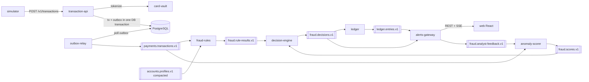

# FraudStream

Real-time payment fraud detection platform: event-driven microservices on **Kafka**, **NestJS/TypeScript**, **PostgreSQL** and a **React + Tailwind** analyst dashboard, with PCI DSS-inspired secure coding and anomaly detection.

> This project demonstrates controls inspired by PCI DSS v4.0. It is not a certified or production-ready payment system.

- Specification: [`docs/SPEC.md`](docs/SPEC.md) (single source of truth)
- Planning: [`openspec/`](openspec) — one OpenSpec change per milestone (SPEC §17)
- Decisions: [`docs/adr/`](docs/adr/README.md)
- Operations: [`docs/runbook.md`](docs/runbook.md)

## Status

| Milestone | Scope                                                 | State       |
| --------- | ----------------------------------------------------- | ----------- |
| M0        | Monorepo, local Kafka + Postgres, event contracts, CI | in progress |
| M1–M8     | See SPEC §17                                          | planned     |

## Architecture



## Quick start

Requirements: Node.js 22 (`.nvmrc`), pnpm 10 (`corepack enable`), Docker with Compose v2.

```bash
pnpm i
cp .env.example .env
docker compose --profile core up -d --wait   # 3 Kafka brokers (KRaft) + Postgres + kafka-ui
pnpm topics:verify                           # cluster matches the topic catalogue
open http://localhost:8080                   # kafka-ui
```

Low on RAM? Use `--profile lowmem` instead of `--profile core` (one broker, replication factor 1). Do not run both profiles at once.

| Service      | Address                                                                             |
| ------------ | ----------------------------------------------------------------------------------- |
| Kafka (host) | `localhost:19092`, `localhost:29092`, `localhost:39092`                             |
| PostgreSQL   | `localhost:5432`, database `fraudstream`, one role per service (see `.env.example`) |
| kafka-ui     | <http://localhost:8080>                                                             |

## Development

```bash
pnpm lint          # ESLint (typescript-eslint strict + eslint-plugin-security) on every project
pnpm typecheck     # tsc --noEmit, strict mode
pnpm test          # Vitest unit tests (pnpm test:coverage for coverage)
pnpm format        # Prettier
pnpm topics:generate   # regenerate infra/kafka/topics.conf after editing libs/contracts/src/topics.ts
```

Commits follow [Conventional Commits](https://www.conventionalcommits.org); Husky runs Prettier + ESLint on staged files and commitlint on the message.

## Repository layout

```
apps/        services (from M1)
libs/        shared libraries — contracts (event schemas, topics)
infra/       docker compose, Kafka topic init, Postgres roles
migrations/  per-service SQL migrations (from M1)
scripts/     operational scripts
tests/       e2e, load, chaos, security suites
docs/        SPEC, ADRs, runbook
openspec/    OpenSpec planning (changes per milestone)
```
