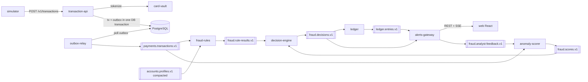

# FraudStream

Real-time payment fraud detection platform: event-driven microservices on **Kafka**, **NestJS/TypeScript**, **PostgreSQL** and a **React + Tailwind** analyst dashboard, with PCI DSS-inspired secure coding and anomaly detection.

> This project demonstrates controls inspired by PCI DSS v4.0. It is not a certified or production-ready payment system.

- Specification: [`docs/SPEC.md`](docs/SPEC.md) (single source of truth)
- Planning: [`openspec/`](openspec) — one OpenSpec change per milestone (SPEC §17)
- Decisions: [`docs/adr/`](docs/adr/README.md)
- Operations: [`docs/runbook.md`](docs/runbook.md)

## Status

| Milestone | Scope                                                   | State       |
| --------- | ------------------------------------------------------- | ----------- |
| M0        | Monorepo, local Kafka + Postgres, event contracts, CI   | done        |
| M1        | Ingestion API, card vault, transactional outbox         | done        |
| M2        | Kafka consumer library: idempotency, retry, DLQ, replay | done        |
| M3        | Fraud rules, anomaly scorer, decision engine            | done        |
| M4        | Ledger                                                  | done        |
| M5        | Alerts gateway and auth                                 | done        |
| M6        | Analyst dashboard                                       | in progress |
| M7–M8     | See SPEC §17                                            | planned     |

## Architecture



## Quick start

Requirements: Node.js 22 (`.nvmrc`), pnpm 10 (`corepack enable`), Docker with Compose v2.

```bash
pnpm i
pnpm env:init                                  # .env from .env.example with fresh random keys/tokens
docker compose --profile core up -d --build --wait   # Kafka (3 brokers, KRaft), Postgres, kafka-ui, services
pnpm topics:verify                             # cluster matches the topic catalogue
pnpm apikey:create demo                        # prints an API key once (only its hash is stored)
```

Send an authorization request (SPEC §6.1):

```bash
curl -i -X POST localhost:3000/v1/transactions \
  -H 'content-type: application/json' \
  -H "x-api-key: $API_KEY" \
  -H "idempotency-key: $(uuidgen)" \
  -d '{"accountId":"acc_000123","card":{"pan":"4111111111111111","expiryMonth":12,"expiryYear":2029,"cvv":"123"},
       "amount":{"value":"1250.90","currency":"BRL"},
       "merchant":{"id":"mer_771","name":"Loja Exemplo","mcc":"5732","country":"BR","city":"São Paulo"},
       "channel":"ECOMMERCE","entryMode":"CARD_NOT_PRESENT",
       "device":{"ip":"203.0.113.10","deviceId":"d-123"},"geo":{"lat":-23.55,"lon":-46.63}}'
# 202 {"transactionId":"…","status":"PENDING","links":{"self":"/v1/transactions/…"}}
```

The event appears on `payments.transactions.v1` in kafka-ui, keyed by `accountId`, with the vault token and the masked PAN only. Within a few hundred milliseconds `GET /v1/transactions/:id` shows the decision (`APPROVED`, `REVIEW` or `DECLINED`, ADR-005), and an approval is posted to the ledger as a balanced journal on `ledger.entries.v1`.

```bash
pnpm ledger:reconcile    # read-only reconciliation report (docs/sql/reconciliation.sql); exit 1 when dirty
```

REVIEW and DECLINE decisions become alerts in the analyst API (alerts-gateway, SPEC §6.8):

```bash
pnpm users:seed          # analyst@demo.local / admin@demo.local, passwords from .env (DEMO_*_PASSWORD)
TOKEN=$(curl -s -X POST localhost:3006/auth/login -H 'content-type: application/json' \
  -d "{\"email\":\"analyst@demo.local\",\"password\":\"$DEMO_ANALYST_PASSWORD\"}" | jq -r .accessToken)
curl -s localhost:3006/v1/alerts -H "authorization: Bearer $TOKEN" | jq
```

The OpenAPI document is at <http://localhost:3006/docs>. The analyst console runs at <http://localhost:8081> (see [docs/frontend.md](docs/frontend.md); Figma file pending, design tokens in `apps/web/src/styles/tokens.ts`). Upgrading an existing checkout: add `DEMO_ANALYST_PASSWORD`, `DEMO_ADMIN_PASSWORD` and `CORS_ORIGINS` to `.env` (see `.env.example`).

Low on RAM? Use `--profile lowmem` instead of `--profile core` (one broker, replication factor 1). Do not run both profiles at once.

| Service              | Address                                                                             |
| -------------------- | ----------------------------------------------------------------------------------- |
| transaction-api      | <http://localhost:3000> (`/v1/transactions`, `/health/ready`)                       |
| card-vault           | internal only (no published port)                                                   |
| outbox-relay metrics | <http://localhost:9464/metrics>                                                     |
| fraud-rules          | <http://localhost:3002> (`/health/ready`, `/metrics`)                               |
| anomaly-scorer       | <http://localhost:3003> (`/health/ready`, `/metrics`)                               |
| decision-engine      | <http://localhost:3004> (`/health/ready`, `/metrics`)                               |
| ledger               | <http://localhost:3005> (`/health/ready`, `/metrics`)                               |
| alerts-gateway       | <http://localhost:3006> (analyst API, SSE `/v1/stream`, OpenAPI at `/docs`)         |
| web (dashboard)      | <http://localhost:8081> (analyst console; `pnpm users:seed` creates the logins)     |
| Kafka (host)         | `localhost:19092`, `localhost:29092`, `localhost:39092`                             |
| PostgreSQL           | `localhost:5432`, database `fraudstream`, one role per service (see `.env.example`) |
| kafka-ui             | <http://localhost:8080>                                                             |

## Development

```bash
pnpm lint          # ESLint (typescript-eslint strict + eslint-plugin-security) on every project
pnpm typecheck     # tsc --noEmit, strict mode
pnpm test          # Vitest unit tests (pnpm test:coverage for coverage)
pnpm test:integration  # Testcontainers PostgreSQL + Kafka (needs Docker)
pnpm test:security     # PAN/CVV leak test and SQL injection payloads against the real services
pnpm test:contracts    # producer fixtures validated against consumer schemas, per topic
pnpm test:e2e          # end-to-end against the running compose stack (card testing burst → DECLINED)
pnpm db:migrate        # apply migrations/<service> as each service's own role (services also do it at start)
pnpm format        # Prettier
pnpm topics:generate   # regenerate infra/kafka/topics.conf after editing libs/contracts/src/topics.ts
```

### Ledger (SPEC §5.6, §6.7)

- Approvals become one journal (customer `DEBIT`, merchant `CREDIT`); `REVIEW` and `DECLINE` move no money.
- `FraudDecisionMade` carries no amount or merchant (SPEC §4.9), so the ledger keeps a projection of `payments.transactions.v1` and joins it with the decision; a decision that arrives first is retried until the transaction is projected. Adding the fields to the decision event was rejected to keep its payload as specified.
- The database enforces the invariants: a deferred constraint trigger rejects unbalanced journals at commit, `ledger_svc` cannot update, delete or truncate entries (journals are protected by a trigger, since the foreign key check needs `UPDATE` on them), and `journals.transaction_id` is unique.
- Balances use optimistic locking (`version`), retried on conflict.
- Reconciliation runs as the read-only `reconciler` role. Upgrading an existing checkout: add `DATABASE_URL_RECONCILER` to `.env` (see `.env.example`) and recreate the Postgres volume (`docker compose --profile core down -v`), since roles are created on first start only.

Commits follow [Conventional Commits](https://www.conventionalcommits.org); Husky runs Prettier + ESLint on staged files and commitlint on the message.

## Repository layout

```
apps/        card-vault, transaction-api, outbox-relay
libs/        contracts, db, kafka, outbox, http, security, observability, testing
infra/       docker compose, Kafka topic init, Postgres roles
migrations/  per-service SQL migrations
scripts/     operational scripts
tests/       e2e, load, chaos, security suites
docs/        SPEC, ADRs, runbook
openspec/    OpenSpec planning (changes per milestone)
```
