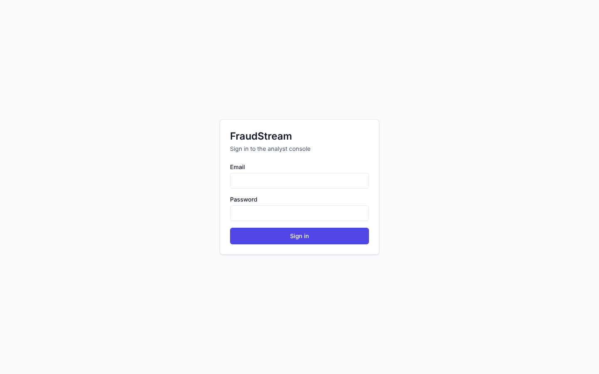
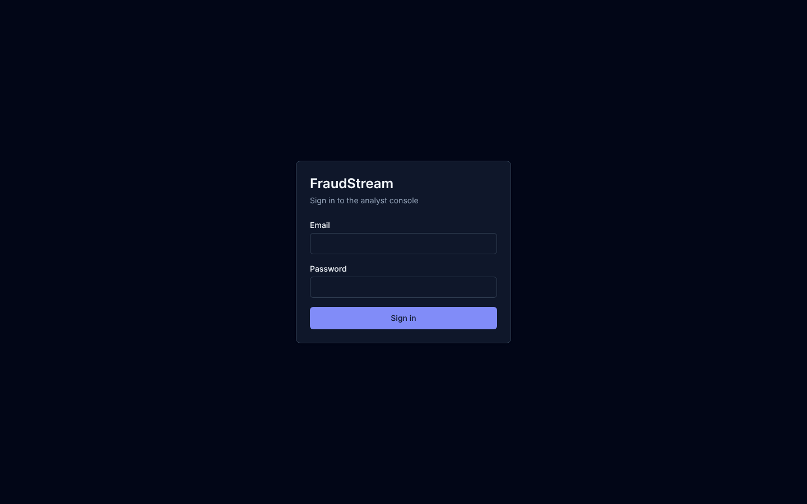
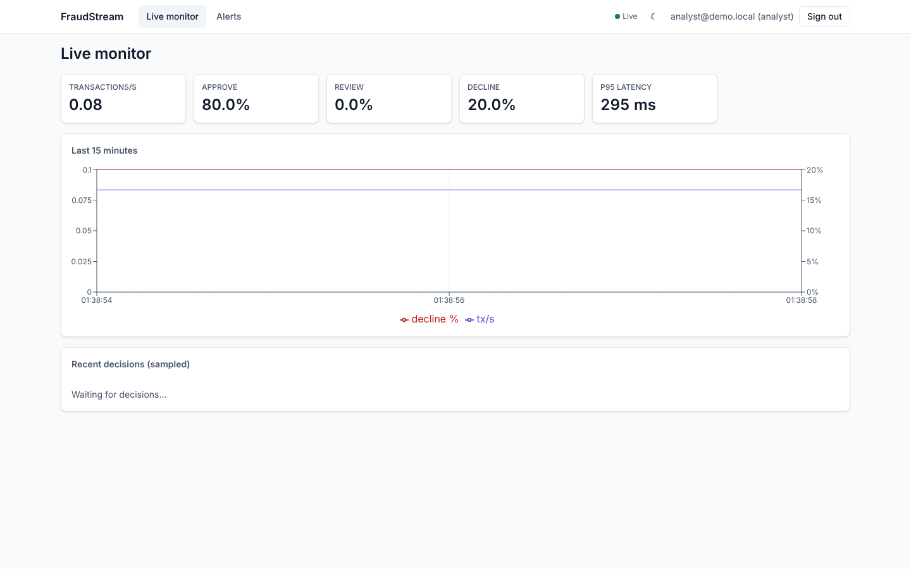
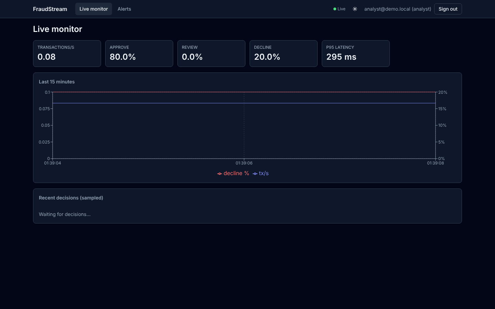
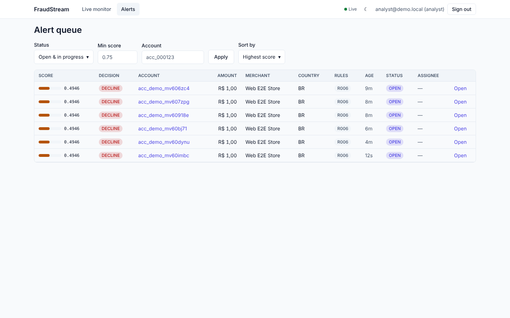
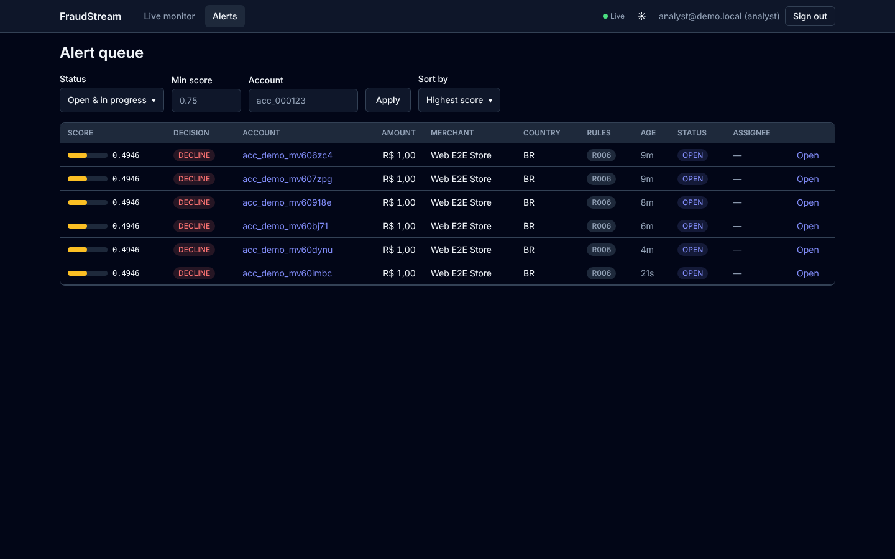
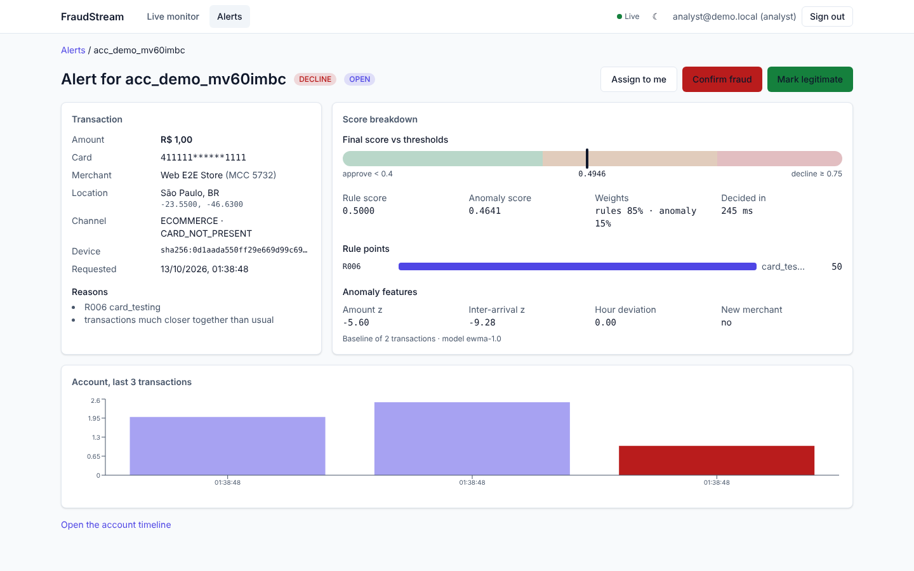
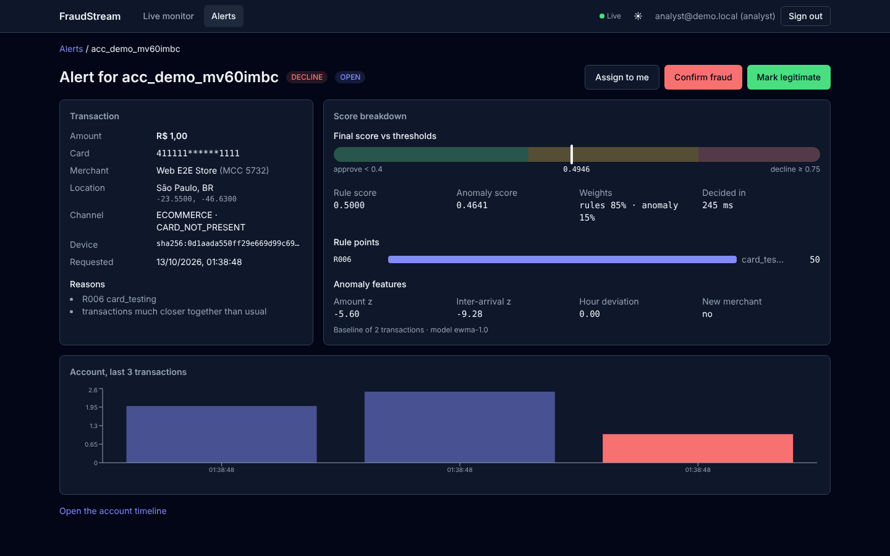
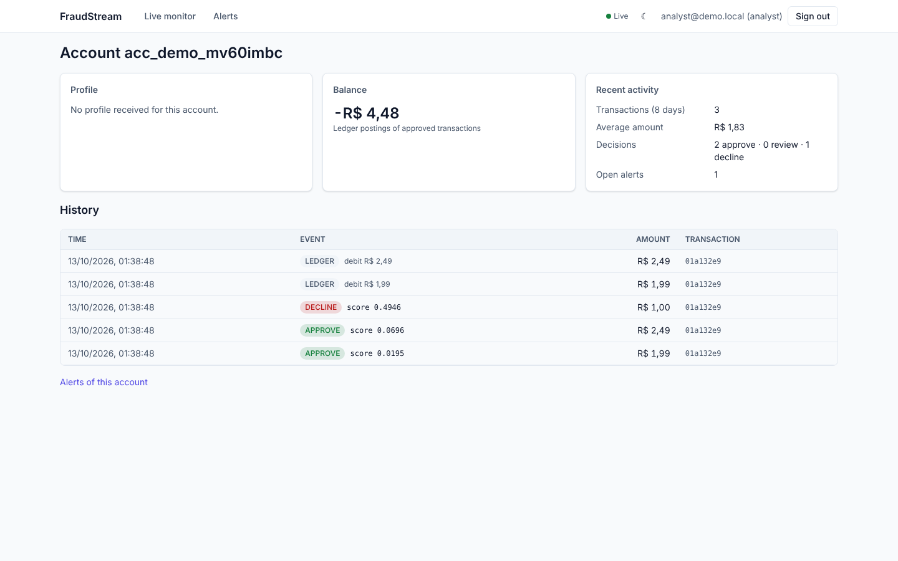
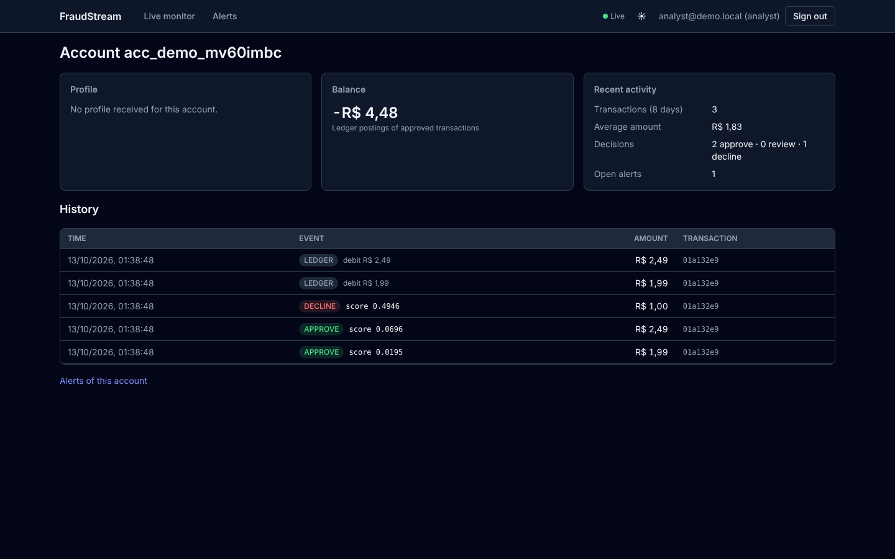

# Analyst dashboard (`apps/web`)

The web console analysts use to watch the platform live, triage alerts and investigate accounts
(SPEC §8). It is served by its own container (Caddy, port 8081), which also proxies the
alerts-gateway on the same origin.

## Design (SPEC §8.1)

> **Figma file: pending.** M6 started tokens-in-code first (the design tool was not reachable
> from the build environment). The tokens below are the source of truth. Import
> [`frontend/tokens-studio.json`](frontend/tokens-studio.json) into Figma with Tokens Studio
> ("Load from file") to create the variables (collection _FraudStream_, modes _Light_ and
> _Dark_). Then add the link here and a _Figma_ column to the comparison table. Regenerate the
> JSON with `pnpm --filter @fraudstream/web tokens:export`.

| Token group | Source                                         | Tailwind                                     |
| ----------- | ---------------------------------------------- | -------------------------------------------- |
| Colors      | `colors.light` / `colors.dark` (semantic, RGB) | `bg-surface`, `text-fg-muted`, `bg-decline`… |
| Spacing     | `spacing` (4 px grid)                          | extends `p-4`, `gap-3`…                      |
| Type scale  | `fontSize` (size + line height), `fontFamily`  | `text-sm`, `text-2xl`…                       |
| Radius      | `radius`                                       | `rounded-md`, `rounded-full`…                |

Colors become CSS variables (`--color-*`) through a Tailwind plugin, at build time. Dark mode
(`class` strategy) only swaps the variable values, so it needs no runtime style injection and
fits the CSP. Color meaning is consistent everywhere:

- `approve` (green): APPROVE and LEGITIMATE;
- `review` (amber): REVIEW and IN_PROGRESS;
- `decline` (red): DECLINE and CONFIRMED_FRAUD;
- `primary` (indigo): OPEN alerts.

## Screens

Implementation screenshots, light and dark, from the compose stack with real traffic.
Regenerate them with `pnpm --filter @fraudstream/web screenshots`.

| Screen           | Light                                    | Dark                                    |
| ---------------- | ---------------------------------------- | --------------------------------------- |
| Login            |             |             |
| Live Monitor     |      |      |
| Alert Queue      |       |       |
| Alert Detail     |      |      |
| Account Timeline |  |  |

## Engineering (SPEC §8.3)

- **Structure.**
  - Features live in `src/features/{auth,monitor,alerts,accounts}`.
  - Shared parts:
    - `src/components/ui`: Button, Badge, Card, Table, Dialog, Input, Select, Toast and ScoreBar, built on Radix with visible focus and ARIA.
    - `src/lib`: the API client, the event stream and the session.
  - Each screen is a lazy route: its own chunk.
- **Types.**
  - Types are generated from the gateway's OpenAPI document by `pnpm web:types`, using `openapi-typescript` and `openapi-fetch`.
  - The document comes from the same Zod schemas the gateway validates with.
- **Auth.**
  - The access token is kept in memory only. Nothing goes to `localStorage` or `sessionStorage`; tests check this.
  - The refresh token is an httpOnly cookie scoped to `/auth`.
  - On a 401 the client refreshes once and retries once. The refresh is single-flight, because two parallel rotations would look like token reuse and revoke the session.
  - After a reload, the session comes back from the cookie.
- **Live data.**
  - There is one `EventSource` per tab. Its cookie comes from `POST /auth/stream-session` (ADR-006).
  - Events write straight into the TanStack Query cache:
    - `alert.created` adds to the queue (inserted live, or counted as "N new alerts" when scrolled down);
    - `alert.updated` patches the lists and the detail;
    - `decision.made` feeds the decision feed (max 200 rows, virtualized);
    - `metrics.tick` feeds a rolling 15-minute window.
  - Reconnection after an expired session passes `?lastEventId=`, so missed alerts are replayed.
- **Forms.** React Hook Form and Zod, with the same limits as the gateway (note required, at most 2,000 characters).
- **Optimistic updates.** Assign and resolve update the detail immediately. If the gateway refuses, they roll back and show an error toast (on 409: "already resolved").
- **Accessibility.** Every interactive element is keyboard operable:
  - Dialogs return focus to their opener.
  - Selects work with the arrow keys.
  - The feed is a focusable scroll region.
  - There is a skip link, and charts have text alternatives.
  - axe-core runs in the component tests, and jsx-a11y in the linter.

## Delivery and quality

- **Container.** `infra/docker/web.Dockerfile` serves the Vite build with Caddy (`infra/web/Caddyfile`):
  - CSP: `script-src 'self'` (no inline scripts), `connect-src 'self'`, `frame-ancestors 'none'`. Inline styles are allowed because React style attributes and the chart library need them.
  - Other headers: `nosniff`, `Referrer-Policy: no-referrer`, and a Permissions-Policy.
  - Hashed assets are cached as immutable.
  - The SSE route is proxied without buffering.
- **Tests.**
  - Vitest and Testing Library cover components and screens (`pnpm --filter @fraudstream/web test`).
  - Playwright runs the main flow against the running stack: log in, an alert appears via SSE after a real card-testing burst, resolve it, and the status persists after a reload (`pnpm --filter @fraudstream/web test:e2e:web`).
- **Performance.**
  - `pnpm --filter @fraudstream/web lighthouse` logs in and audits `/alerts` (desktop preset), and fails below 90.
  - Last run: **100** (LCP 0.3 s, TBT 0 ms, CLS 0).
  - The HTML report is written to `apps/web/lighthouse/` (a CI artifact).
  - The queue route does not load the chart library.

```bash
docker compose --profile core up -d --build --wait   # includes the web container
pnpm users:seed                                       # analyst@demo.local / admin@demo.local
open http://localhost:8081                            # dev server instead: pnpm --filter @fraudstream/web dev (port 5173)
```
